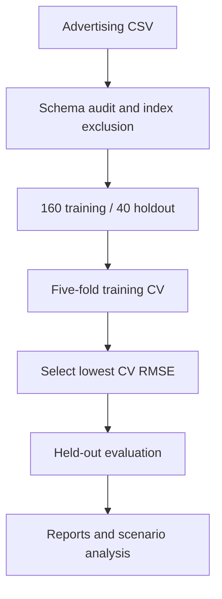

# Sales Prediction

**Marketing analytics · Supervised regression**


[](https://github.com/nisa3131/_SalesPrediction/actions/workflows/validate.yml)

[Explore Notebook](analysis.ipynb) · [Results & Metrics](outputs/metrics.json) · [Technical Report](REPORT.md) · [Download Project](https://github.com/nisa3131/_SalesPrediction/archive/refs/heads/main.zip)

## Overview

A reproducible regression pipeline that estimates sales from TV, radio and newspaper advertising measurements. Designed as a marketing analytics portfolio project with baseline comparison, independent holdout evaluation and scenario analysis.

**Technology stack:** Python 3.12 · Jupyter · pandas · scikit-learn · Matplotlib · Seaborn · GitHub Actions

## Performance snapshot

| Metric | Recorded result |
|---|---:|
| Observations | 200 |
| Selected model | Quadratic ridge (α = 1) |
| Held-out MAE | 0.485 |
| Held-out RMSE | 0.621 |
| Held-out R² | 0.988 |

Values are from the committed analysis artifacts; they are not newly benchmarked or production guarantees.

## System workflow



## Dataset

[Advertising.csv](data/Advertising.csv) contains 200 observations of TV, Radio, Newspaper and Sales. The verified sequential identifier is excluded. No missing measurements or duplicate observations were found after ignoring the identifier. Units and upstream reuse rights are unverified. The task document references [Kaggle Advertising.csv](https://www.kaggle.com/datasets/bumba5341/advertisingcsv).

## Methodology & validation

- Seed 42 fixes an 80/20 split; five-fold CV uses only training rows.
- Imputation, scaling, interaction and polynomial transformations are fitted within each fold.
- Compare dummy mean, linear regression, ridge, TV × Radio interaction, quadratic ridge and random forest.
- Select by mean CV RMSE before evaluating the untouched test set.

## Results & interpretation

| Model | Test MAE ↓ | Test RMSE ↓ | Test R² ↑ |
|---|---:|---:|---:|
| Mean baseline | 4.963 | 5.631 | -0.005 |
| **Quadratic ridge** | **0.485** | **0.621** | **0.988** |

The selected model's mean CV RMSE is 0.671. The training-only linear reference shows stronger conditional associations for TV and radio than newspaper. The scenario analysis illustrates model sensitivity, not causal uplift or guaranteed ROI.


## Repository structure

```text
analysis.ipynb              Interactive notebook with saved outputs
analysis.py                 Shared reproducible analysis pipeline
data/                       Supplied input CSV files
outputs/                    Metrics, reports, predictions or analytical tables
report/                     PDF and editable report exports
requirements.txt            Pinned analysis dependencies
requirements-notebook.txt   Optional notebook tooling
.github/workflows/          Automated analysis validation
```

## Quick start

Use Python 3.12 (the CI runtime). No API keys, GPU or paid services are required.

```powershell
git clone https://github.com/nisa3131/_SalesPrediction.git
cd _SalesPrediction
python -m venv .venv
.venv\Scripts\python.exe -m pip install -r requirements.txt
.venv\Scripts\python.exe analysis.py
```

On Linux/macOS, use `.venv/bin/python` instead of `.venv\Scripts\python.exe`.

**Jupyter:** install the optional notebook requirements and JupyterLab in the same environment, then launch from the repository root:

```powershell
.venv\Scripts\python.exe -m pip install -r requirements-notebook.txt jupyterlab
.venv\Scripts\python.exe -m jupyterlab
```

Open `analysis.ipynb`, select the project environment and run all cells. The notebook uses the shared Python implementation. To customize input and output paths (with the environment activated):

```bash
python analysis.py --data data/Advertising.csv --output-dir outputs
```

## Quality & reproducibility

The [GitHub Actions workflow](.github/workflows/validate.yml) installs pinned dependencies and reruns the analysis on Python 3.12. Source files remain unchanged; generated results are refreshed in `outputs/`. See the workflow badge and Actions tab for current CI status.

## Artifacts

| Resource | Purpose |
|---|---|
| [Notebook](analysis.ipynb) | Interactive analysis and saved visualizations |
| [Metrics JSON](outputs/metrics.json) | Machine-readable experiment or analysis results |
| [Detailed results](outputs/summary.md) | Methods, findings and reproducibility |
| [Held-out predictions](outputs/heldout_predictions.csv) | Actuals, predictions and residuals |
| [Tables](outputs/tables/) | CV comparison, associations and scenarios |
| [Charts](outputs/charts/) | Exploratory and diagnostic figures |
| [PDF report](report/report.pdf) · [DOCX report](report/report.docx) | Report exports |

## Limitations & deployment readiness

The dataset has no dates, verified measurement units, customer segments or online-channel variables. Random holdout performance is not a future sales forecast. External validation and controlled marketing experiments are required before operational budget decisions.

Portfolio analysis project; no production deployment, external validation or dataset license is asserted.

## Internship submission archive

Developed as part of the CodeAlpha Data Science internship project collection. The [shared submission folder](https://github.com/nisa3131/_IrisFlowerClassification/tree/main/submission) contains the combined package, reports and submission guidance. The technical README is intended for engineering review; separate internship submission obligations are not part of the executable pipeline.
